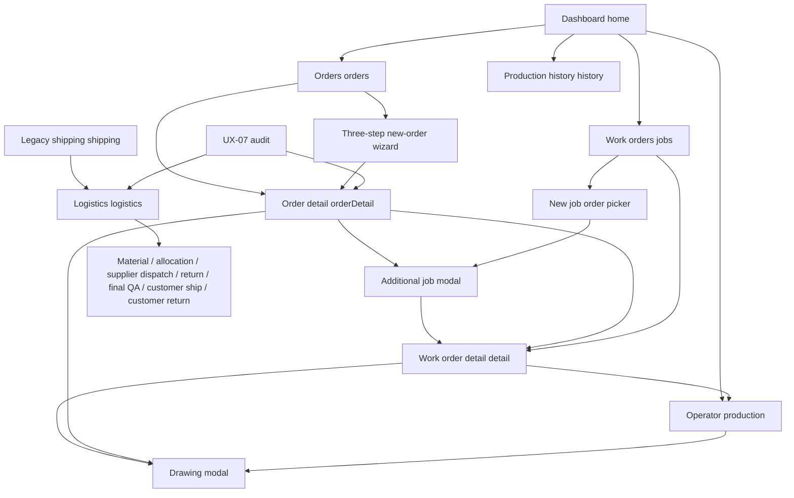
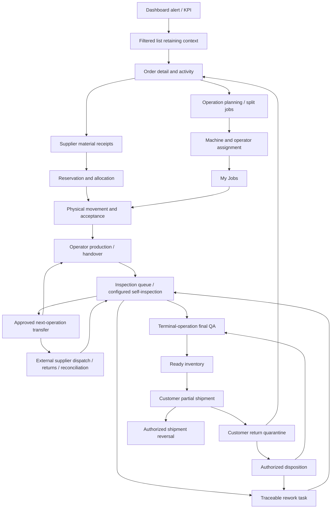

# Screen navigation and role structure

Baseline `a28d562`, 26 October 2026. “Current” describes existing code; “required” describes the missing target journeys. Runtime confirmation and limits are in [test results](UX_E2E_TEST_RESULTS.md).

## Current routes

Main app uses a global `view`, not URL routes. Refresh starts at home; browser Back is not connected to screen navigation. `go()` clears shared search/filter state. `chosenJob` is overloaded for an order, a work order and the drawing modal's order.

| Route / dialog | Access today | Context / back behavior | Failure or gap |
|---|---|---|---|
| `home` | Desktop and mobile navigation | Default route | KPI cards call plain `go`; no KPI-specific filter. Delayed-order/pause alert record links exist. |
| `orders` → `orderDetail` | Cards and audit links | Back calls `go('orders')` | Search/filter lost; status/counts use snapshot data. |
| New-order wizard | Dashboard and orders | Steps 1→2→3→order detail; cancel available | Customer/product suggestions after 3 chars; file upload only after creation; due-date/operation-policy gaps. |
| `jobs` → `detail` | Cards/order related jobs | Tabs general/route/logs; back always jobs | Does not restore source order or filtered job list. |
| New job picker / additional-job modal | Jobs toolbar or order detail | Existing order preselected only via order detail | No operation/quantity/operator choice; picker backdrop differs from shared dialog styling. |
| `production` | Machine card or job detail; mobile navigation | Chooses current job by machine | Unassigned job defaults to CNC-01, opening another job. No My Jobs or operator assignment route. |
| Drawing modal | Order/job detail and operator | Close empties overlay; Escape supported | Mutates selected record ID; next job-detail tab can be empty. No revision history. |
| Inspection/rework/shift sections | Within operator screen | No dedicated route or backlog | Quality actions depend on manager dropdown; no next-operation action. |
| `shipping` | Desktop/mobile | Legacy history plus “Yeni Sevkiyat Ekranı” link after rerender | Separate ledger; disabled old buttons leave old mutation function alive. |
| `logistics` | Desktop added sidebar and mobile Fason after rerender; shipping link | Own order select and seven action tabs | Entering from unrelated record does not set current order; first falls back to first order. No source/destination lot detail. |
| `history` | Desktop; dashboard recent-events “Tümü” | All production events only | No direct bottom-nav entry; logistics history stays separate. |
| `audit` | Desktop added sidebar after rerender | Links order detail and generic logistics | No mobile nav entry; table causes whole-document horizontal overflow. |

First paint uses the original shell before extension wrappers. Thus extra sidebar entries and Fason bottom item need a subsequent render. Mobile later shows six bottom items, while desktop includes history, logistics and audit. There is no single role-aware menu or mobile “More” route. The alternative sales HTML has independent routes `dashboard/orders/work/machines/operator/shipping/history/detail`, unrelated state, different users, and no UX-05/06/07 screens.

## Required complete journeys

Order detail must open production, material, supplier and shipping screens with order/operation context already set. Every movement/history record must link to its originating order, operation, job, lot and document. Lists should retain filters and scroll when returning. Transfer detail, inspection detail, supplier discrepancy closure, return disposition, reversal, reservation release, compensation production, revision history and recovery are missing screens or missing contextual workflows, not merely new menu labels.

The final inspection gate requires terminal-operation eligibility. A supplier return is not automatically customer-ready. Shipment completion is `net customer shipped / ordered`; external dispatch never advances that percentage. Returns reopen remaining demand. The diagram describes the required behavior, not behavior currently verified.

## Role and action access

**Current:** every user can select Operatör A/B/C or Yönetici. There is no login, authenticated role, operator assignment, server permission check or route restriction. UX-05 direct good/inspection/rework and UX-06 final approval compare the selected display name with Yönetici; other screens/actions largely remain accessible. Handover requires a different selected username. These are demo UI rules, not a security boundary.

The following is a proposed access contract for implementation, not an assertion of existing roles:

| Role | Primary screens/actions | Restricted actions |
|---|---|---|
| Planner / supervisor | Orders, operation-specific jobs, schedule, machine/operator assignment, remaining-plan revision, compensation | No unapproved material release or customer shipment override |
| Operator | My Jobs, approved drawing, physical acceptance, start/pause/resume, result entry, handover | Self-inspection only where operation policy authorizes; no arbitrary reassignment or final release |
| Quality inspector | Inspection backlog, disposition, rework/reinspection, final approval | Conditional release disabled by default; any future exception explicit and audited |
| Material / warehouse | Receipts, stock allocation, transfer issue/acceptance | No stock creation by counter edits; no quality-status override |
| External operations coordinator | Supplier dispatch, partial returns and reconciliation | Discrepancy write-off only with separate authority and recorded reason |
| Shipping | Approved ready lots, partial shipment, waybill, return receipt | No shipment without final QA; reversal permission explicit |
| Authorized manager | Approve discrepancy closure/reversal and exceptional plan changes | Each action validates current eligible quantities and records reason; no anonymous override |
| Read-only auditor | Cross-module reconciliation and traceability | No mutation during read/render; no silent ledger creation |

Users may hold multiple roles. Enforce permissions in shared commands/service and then reflect them in navigation. Keep demo users and fixtures fictional. Preserve existing browser data through explicit versioned migrations rather than resetting it to implement this map.
